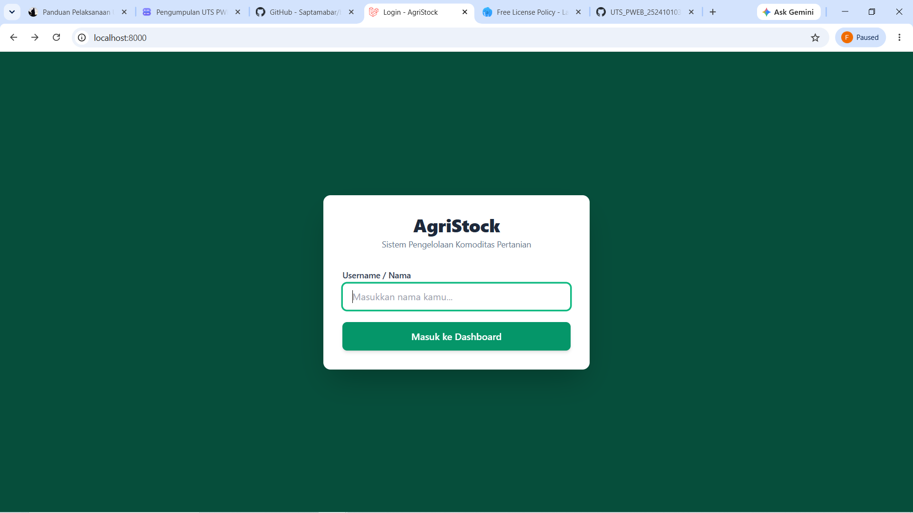
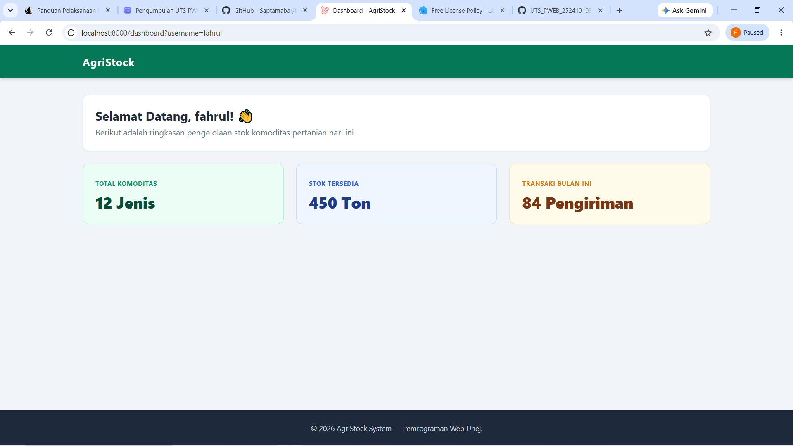

# UTS Pemrograman Web - AgriStock System

**Nama:** Fahrul Maulana Ramadhan  
**NIM:** 252410103004  
**Kelas:** Pemrograman Web A  
**Program Studi:** Teknologi Informasi / Ilmu Komputer - Universitas Jember  

---

## Deskripsi Singkat Aplikasi
**AgriStock** adalah aplikasi web berbasis **Laravel 11** yang dirancang untuk mensimulasikan sistem pengelolaan stok dan distribusi komoditas pertanian (Palawijo). Aplikasi ini dibangun dengan menerapkan arsitektur **MVC (Model-View-Controller)**, perulangan dinamis Blade Templating Engine, serta antarmuka modern menggunakan **Tailwind CSS**.

Sistem ini berfokus pada alur *Request-Response* tanpa database, di mana data identitas pengguna diteruskan secara dinamis dari form login menuju Dashboard dan Halaman Profil.

---

## Tampilan Aplikasi (Screenshot)

### 1. Halaman Login
*Halaman utama untuk memasukkan nama/username pengakses aplikasi.*

### 2. Halaman Dashboard
*Menampilkan statistik stok komoditas serta ucapan selamat datang dinamis yang membawa nama pengguna dari alur request.*

### 3. Halaman Pengelolaan Stok
*Menampilkan daftar data inventaris komoditas pertanian yang dirender secara dinamis dari Controller.*

### 4. Halaman Profil
*Menampilkan detail informasi pengguna dan status hak akses sistem.*

---

## Fitur & Arsitektur Utama
1. **Arsitektur MVC:** Seluruh data komoditas dan logika alur ditangani di `PageController.php`.
2. **Dynamic Request Handling:** Menangkap data `username` dari form login dan meneruskannya via *query parameters* tanpa database.
3. **Blade Component Layout:** Menggunakan komponen terpisah untuk Layout Utama (`app.blade.php`), Navbar (`navbar.blade.php`), dan Footer (`footer.blade.php`).
4. **Responsive UI:** Tampilan antarmuka yang bersih dan responsif menggunakan Tailwind CSS.

---

